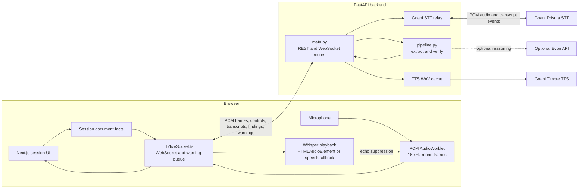

# VeriLex: Verifiable Legal & Agreement Intelligence
*The witness in your ear.*

[📄 One-page solution pitch (PDF)](VeriLex_Solution_Pitch.pdf) · [🎥 Demo video](https://youtu.be/6tNNkigYx5E) · [💼 LinkedIn post](https://lnkd.in/p/gAy8dEJ3) · [🌐 Prototype (demo mode)](https://verilex-jade.vercel.app)

> **For judges:** VeriLex listens to a sales conversation, checks the agent's spoken promises against the written agreement, and plays a quiet warning in the user's earbud when they don't match.
> **Live today:** Gnani Prisma v2.5 (speech to text) and Timbre v2.5 (text to speech). **In progress:** Evon v3.3 (reasoning); verification is rule-based for now.
> Built for the Great Indian AI Internship Challenge by Gnani AI.

## Product screenshots

### Why VeriLex


### How it works


### AI models


### Evidence report


## What it does

- Streams conversation audio to Gnani Prisma v2.5 for speech recognition.
- Detects spoken commitments and compares supported claims with document facts.
- Sends a short voice warning through Gnani Timbre v2.5 when a high or medium severity contradiction is found.
- Supports an optional OpenAI-compatible Evon endpoint for commitment extraction and verification, with a rule-based fallback.
- Keeps a scripted Demo mode available without connecting to the live backend.

The prototype is decision support, not legal advice. Review the source document and seek qualified advice for important decisions.

## Try it in 60 seconds

1. Open the [prototype](https://verilex-jade.vercel.app). It runs in **Demo mode**, so no microphone or API key is needed.
2. Click **Start a session**, review the extracted clauses, tick the consent box, and start listening.
3. Watch the scripted conversation: the transcript appears, a red contradiction card flags the promise that doesn't match the document, and the warning banner shows.

Live audio (Prisma and Timbre) runs locally with the FastAPI backend and a Gnani API key. See "Run the backend" below. The [demo video](https://youtu.be/6tNNkigYx5E) shows the live pipeline.

## Status and known limitations

| Area | Status |
| --- | --- |
| Live speech to text (Prisma v2.5) and spoken warnings (Timbre v2.5) | Working locally |
| Promise checks | Rule-based, with numbers compared in code |
| Evon v3.3 reasoning | Integration in progress |
| Web app (landing, setup, live session, report, technology pages) | Working; hosted prototype runs in Demo mode |

Known limitations:
- Rule-based checks cover only the phrasings the rules know; Evon is meant to widen this.
- Speaker handling is manual today. Everything is treated as the agent unless marked as the user.
- Noise handling relies on the browser's built-in suppression. Headphones are recommended so the microphone does not pick up the warning.
- Phone-call audio is not accessible to ordinary apps, so calls are not supported yet.

## Roadmap

- **Evon integration:** structured JSON extraction and verification of promises against clauses; numbers stay checked in code.
- **Speaker separation:** voice enrollment (speaker embeddings from a short sample) and diarization to label agent and customer.
- **Noise robustness:** voice-activity detection on a denoised copy, with the original audio still sent to Prisma, A/B tested on word error rate.
- **Phone calls:** a cloud telephony bridge that streams call audio to the backend, with consent announced on the call.
- **Documents:** PDF and photo parsing with OCR, and downloadable evidence reports.


## Technology

| Area | Stack |
| --- | --- |
| Frontend | Next.js 16, React 19, TypeScript, Tailwind CSS |
| Backend | Python 3.10+, FastAPI, Uvicorn |
| Speech | Gnani Prisma v2.5 STT and Timbre v2.5 TTS |
| Optional reasoning | Evon through an OpenAI-compatible chat completions API |

## Project architecture

The live experience is split between the browser and the FastAPI service. The browser captures and plays audio; the backend holds provider credentials, relays speech to Gnani, evaluates the transcript against the session's document facts, and returns findings and voice warnings.



### Live session flow

1. The browser converts microphone input into signed 16-bit PCM at 16 kHz and sends frames over `/ws/session`.
2. FastAPI relays the frames to Gnani Prisma STT and returns recognized transcripts to the browser. Agent transcripts also enter the verification pipeline; transcripts marked as the user's speech are not analyzed.
3. The pipeline extracts commitments with Evon when enabled, or uses its rule-based fallback. Numeric claims are compared with the supplied document facts in Python.
4. A finding is sent to the browser immediately. For high or medium severity contradictions, the backend gets a WAV warning from Timbre (using an in-memory cache), then sends the warning event.
5. The browser displays the finding and warning, plays the audio in order, and briefly drops microphone frames to reduce feedback from the spoken warning.

The API key is loaded by the backend from `backend/.env`. It is never part of the browser-to-backend session message. Demo mode bypasses this live flow and uses scripted frontend content.

## Run the frontend

Requirements: Node.js and pnpm. The repository declares pnpm as its package manager.

```bash
corepack pnpm install
cp .env.local.example .env.local
corepack pnpm dev
```

Open [http://localhost:3000](http://localhost:3000). Demo mode is enabled by default and does not require backend credentials.

### Enable live mode

Run the backend as described in [`backend/README.md`](backend/README.md). In the root `.env.local`, set:

```dotenv
NEXT_PUBLIC_DEMO_MODE=false
NEXT_PUBLIC_BACKEND_WS_URL=ws://localhost:8000/ws/session
```

Restart the frontend after changing environment variables. The browser will request microphone access when the live session opens. For a deployed HTTPS frontend, configure a `wss://` backend URL and add the frontend origin to the backend's `FRONTEND_ORIGINS` setting.

## Run the backend

```bash
cd backend
python3 -m venv .venv
source .venv/bin/activate
pip install -r requirements.txt
cp .env.example .env
```

Set `GNANI_API_KEY` in `backend/.env` on your machine, then start the API:

```bash
uvicorn main:app --reload --port 8000
```

The backend `.env` is ignored by Git. Keep Gnani and Evon credentials on the backend; never put API keys in frontend variables, source files, or screenshots.

The backend provides:

- `GET /health` for service and credential-presence status.
- `POST /api/tts` for generated WAV audio.
- `GET /api/tts-check` and `POST /api/test-warning` for TTS diagnostics.
- `WS /ws/session` for the live audio session.

See [`backend/README.md`](backend/README.md) for configuration, API examples, clip generation, and deployment details.

## Development checks

```bash
corepack pnpm build
```

The FastAPI service can be checked locally at `http://localhost:8000/health` after it starts. Live speech and TTS checks require a valid backend API key and available Gnani service access.

## Repository layout

```text
app/                 Next.js pages and routes
components/          Shared interface components
lib/                 Frontend API and live socket helpers
backend/             FastAPI application and Gnani integration
public/              Static assets and audio worklet
screen shot/         Product screenshots used above
```

## Privacy and responsible use

- Consent is requested before listening starts.
- Audio is relayed through the backend to Gnani Prisma for transcription. [Add this only after the grep check above: The backend does not save microphone audio.]
- The demo uses synthetic sample data only.
- VeriLex is decision support, not legal advice.

## Author and acknowledgements

Built by Karan Bayas for the Great Indian AI Internship Challenge by Gnani AI, using Gnani's Prisma and Timbre APIs. Evon v3.3 is the planned reasoning layer.
